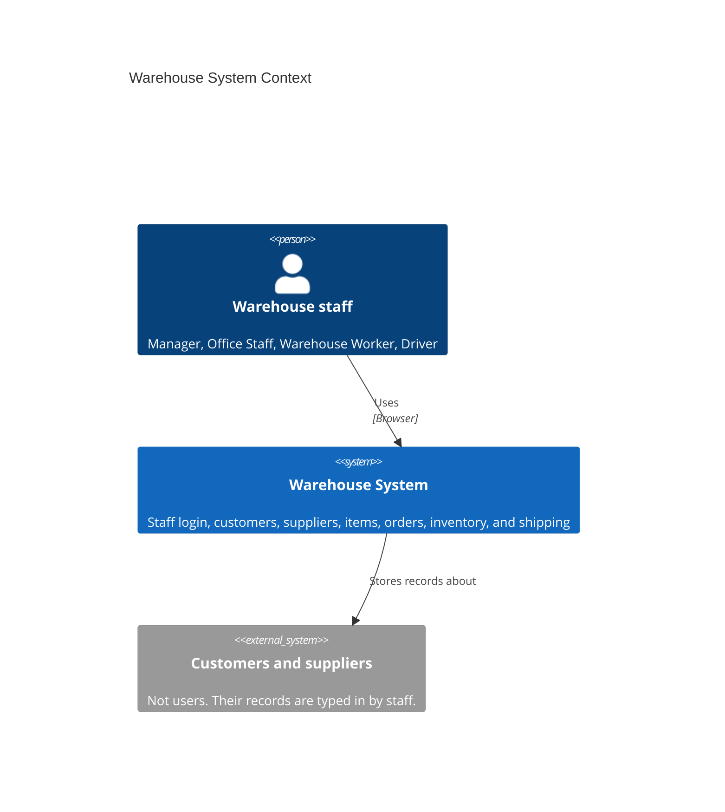
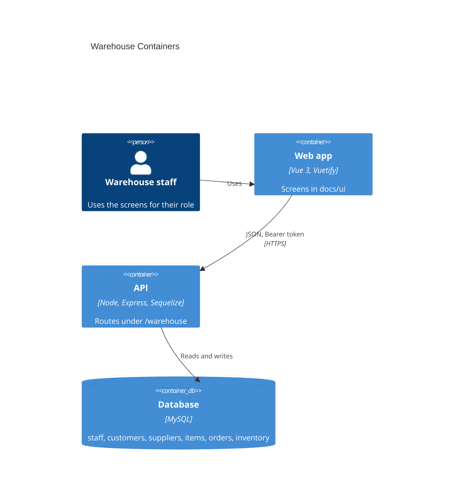
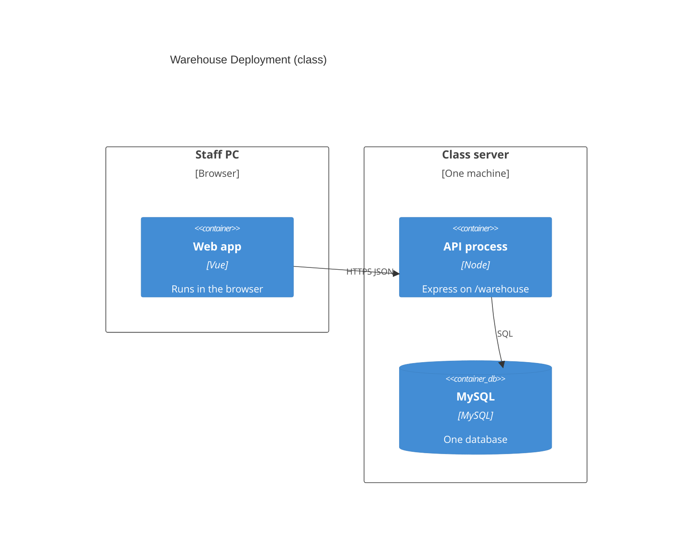

# C4 diagrams

Draw.io files for the warehouse design draft. Open each `.drawio` file in [diagrams.net](https://app.diagrams.net) (Draw.io). The same three views are drawn below in Mermaid so they can be read on GitHub.

| View | File |
|------|------|
| System Context | [c4-context.drawio](c4-context.drawio) |
| Container | [c4-container.drawio](c4-container.drawio) |
| Deployment | [c4-deployment.drawio](c4-deployment.drawio) |

Decisions behind the boxes: [ADR-0001](../adr/0001-vue-express-mysql-stack.md), [ADR-0002](../adr/0002-role-based-shared-warehouse-data.md).

## System Context

## Container

## Deployment

